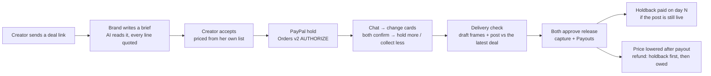

# Amend

**Money that changes when the truth changes.**

Amend is a deal room for creator brand deals. The brand's payment is **held by PayPal before work starts**, every change
in the chat becomes a **priced card both sides confirm**, and nothing is paid out until the **delivery matches the deal**.
Entry for the PayPal AI Hackathon. **PayPal sandbox only. All people and brands are made up.**

**Live:** https://amend-r7le.onrender.com · **Try it in 2 minutes:** https://amend-r7le.onrender.com/try · **Judging guide:** [docs/judging.md](docs/judging.md)

## The problem

- **Late payment.** 48% of creators said they'd been paid late for work that year ([Lumanu, survey of 500+ creators](https://www.lumanu.com/blog/insights-from-500-influencers-on-their-payment-experience)).
  Brands usually pay 30 days after a campaign goes live, terms are stretching to 45 and 60 days, and agencies report some
  payments arriving 120 days late ([Digiday, Jan 2026](https://digiday.com/future-of-tv/future-of-tv-briefing-the-creators-economys-very-loud-dirty-little-secret-of-brands-late-delayed-payments/)).
- **Scope changes.** "One more Story", "post Monday instead", "brighter colours": the deal changes in the chat after the
  price is set, and nobody updates the money.
- **No proof.** When something goes wrong (a cancellation, a dispute), the agreement is scattered across DMs and voice notes.

## How it works



1. **Deal link.** The creator sends one link; the brand needs no account. The brand writes a brief; the AI turns it into
   lines, each with the exact words it came from. Prices come from the creator's own price list (code, not AI).
2. **Money held before work starts.** The brand pays with PayPal; the money is authorised (held), not taken.
3. **Changes agreed by both.** A message, voice note, screenshot or call that changes the deal becomes an inline change
   card: priced from her list, with a ripple preview (what money moves) and an **untouched count**. Both confirm → PayPal
   updates (a new hold for more, collect less for a decrease). Unclear wording ("drop the story set" when there are two)
   asks "Which one?" before anyone can confirm.
4. **Paid when delivery matches.** Draft frames are taken in the browser and checked against the brief; the post is checked
   against the latest confirmed deal (items, date, #ad). No money is released while a gap is open.
5. **Release.** Both approve; PayPal collects; the creator is paid by Payouts, minus a holdback paid on day N if the post
   is still live.
6. **Afterwards.** A price lowered after payment is a **refund, never a cancel**, carried by the holdback first and then by
   a balance taken from the creator's next payout. A cancellation is split from the evidence (with an independent AI
   second opinion). A PayPal dispute freezes the holdback, and the creator can send a one-page proof to PayPal.
   Usage rights have a clock and an "Extend usage" card.

Every payment is in a **ledger** with the words behind it.

## PayPal APIs used

| API | Used for |
|---|---|
| Orders v2: create order, `intent: AUTHORIZE` | Hold the brand's money when the deal is accepted, and for each confirmed increase |
| Orders v2: authorize order | Turn the approved order into an authorisation (the hold) |
| Payments v2: capture authorization (partial, `final_capture`) | Collect at release; a cancellation collects only the creator's share |
| Payments v2: void authorization | Release what isn't collected |
| Payments v2: reauthorize | Renew an old hold before collecting (allowed once, day 4–29) |
| Payments v2: refund capture | A correction after payment: refund, never a cancel |
| Payouts | Pay the creator (and an editor's share) |
| Webhooks: verify-webhook-signature | Every webhook is verified, de-duplicated by event id, and never moves a status backwards |
| Disputes: provide-evidence | Send the deal record for a PayPal dispute, only after the creator approves |
| Invoicing v2 | Tried in the day-1 sandbox probe only; not used in the app |

**Idempotency:** every PayPal write carries its own `PayPal-Request-Id`, stored on the money item, so a retry or a double
tap never creates a second payment. **No PayPal write happens without an approval record** bound to that item and amount.

**Webhook events handled:** `CHECKOUT.ORDER.APPROVED`, `PAYMENT.AUTHORIZATION.CREATED / VOIDED`, `PAYMENT.CAPTURE.COMPLETED /
REFUNDED / REVERSED / DENIED`, `PAYMENT.PAYOUTSBATCH.*`, `PAYMENT.PAYOUTS-ITEM.*`, `CUSTOMER.DISPUTE.CREATED / UPDATED / RESOLVED`.

## AI

| Provider | Job |
|---|---|
| **Gemini** (main) | Brief → deal lines; chat, voice-note and call text → change cards; draft frames → delivery check; "Describe your campaign" → search criteria |
| **Groq** | Whisper speech-to-text for voice notes and call timings; backup chat model if Gemini is busy |
| **NVIDIA** | An independent second opinion on the cancellation split; if it disagrees, both views are shown and people decide |

**The AI never does the maths.** It returns item codes, quantities and quotes; every price, total, split and score is
worked out by code from the creator's list. **No quote, no money:** every quote must appear word for word in its source,
or the AI's answer is rejected. Only confirmed people's words can change money; anyone else's become suggestions.

## Discovery

- **Price privacy per creator:** public (exact prices), a range (her own min–max), or on request (no numbers). Hidden
  prices never appear in any response: price filters use fixed bands, a budget badge says only "fits / slightly above /
  above" (budgets are rounded to a fixed grid so it can't be used to find the price), and a brand sees an on-request
  creator's offer amounts only after she accepts.
- **AI match:** "Describe your campaign" → the AI reads the criteria (each with your exact words); code scores every
  creator with fixed weights (niche, audience country, language, views and engagement, budget fit, availability, track
  record, data quality) and shows the top 10 with "Why this match" reasons built from the score.

## Live-tested on the PayPal sandbox

Full write-up: [docs/live-walk.md](docs/live-walk.md).

| Story | Result |
|---|---|
| Happy path: offer → $530 held → "+1 Story set" → $610 held → draft and post checked → released → creator paid, holdback scheduled | ✅ |
| Cancellation: split 60/40 from evidence, NVIDIA second opinion shown, partial capture + Payouts, rest released, PayPal fee recorded | ✅ |
| Refund after payout: voice note "drop the story set" → one Story set (S102) → $80 refund = $61 from the holdback + $19 owed | ✅ |
| Owed balance recovered from the next payout ($99) | ✅ |
| Call upload: browser converts to WAV, speakers separated, "no change" when nothing changed | ✅ |
| Webhooks: order approved, authorization created, capture completed, capture refunded, payouts batch + item | ✅ verified |
| `/try` judge walk: $70 held → "Add a Story and post Monday" → $95 held | ✅ |
| On-request creator: no amounts before she accepts, real price after, PayPal hold succeeds | ✅ |
| Discover AI match with reasons; no hidden price in any response | ✅ |
| PayPal dispute shield | Tested with PayPal mocked (S126–S130); see live-walk for the sandbox status |

**Tests:** 570 automated tests (PayPal and every AI provider mocked; no test calls a real service).

## Honest limits

- **Sandbox only**, USD only (AED shown at a fixed 3.6725).
- **Platform account + Payouts instead of marketplace mode.** The brand pays Amend's sandbox business account and the
  creator is paid by Payouts. PayPal's marketplace setup (the brand pays the creator directly, with Amend's fee and a
  delayed release) needs PayPal partner approval (the sandbox returned 403 / 422 on 7 Nov). Only the "rail" changes.
- **PayPal fees are a platform cost**, never taken from the creator; in production Amend's own fee covers them.
- **WhatsApp alerts: coming soon** (waiting for Meta template approval). Alerts appear in Amend.
- **Free host:** Render's free plan sleeps when idle, so the first page can be slow.
- The UAE permit check is a format and expiry check only. Collecting a usage-rights extension hold isn't built yet.

## Next

- Retainers with a monthly PayPal hold.
- Usage-rights and Partnership Ads clock with paid extensions collected automatically.
- AI use and likeness as priced deal terms.
- Add a creator by @handle, with an invite to claim her profile.
- Barter deals with an optional cash top-up.
- A reference Reel → a shot list checked at delivery.
- Multi-creator campaigns and quote requests.
- Results reports at 7 and 30 days.

## Run it locally

Prerequisites: Python 3.12, a PayPal developer sandbox app, and sandbox accounts (a business account, plus personal
accounts for the brand, the creator and an editor).

```bash
python3.12 -m venv .venv
.venv/bin/pip install -r requirements.txt
cp .env.example .env      # fill in the values; never commit them
.venv/bin/uvicorn amend.app:app --port 8000
# open http://localhost:8000 (demo creators are seeded on first start)
```

Without PayPal or AI keys, `AMEND_FAKE=1` runs a fake PayPal and a rule-based AI for local browser tests.

Environment variables (values never go in the repo): `PAYPAL_ENV`, `PAYPAL_CLIENT_ID`, `PAYPAL_CLIENT_SECRET`,
`PAYPAL_WEBHOOK_ID`, `DATABASE_URL`, `BASE_URL`, `MONEY_RAIL`, `GEMINI_API_KEY`, `GEMINI_MODEL`, `GROQ_API_KEY`,
`GROQ_MODEL`, `NVIDIA_API_KEY`, `NVIDIA_MODEL`, `AMEND_DEMO_PASSWORD`, `AMEND_SESSION_SECRET`, `AMEND_TICK_SECRET`,
`SANDBOX_BRAND_EMAIL`, `SANDBOX_CREATOR_EMAIL`, `SANDBOX_EDITOR_EMAIL`.

**Tests:** `.venv/bin/pytest -q` (PayPal and AI mocked). Browser checks live in `tests/browser/`.
**How to judge it:** [docs/judging.md](docs/judging.md).

## Safety rules (always on)

1. PayPal sandbox only: the app refuses to start unless `PAYPAL_ENV=sandbox`. Secrets come only from environment variables.
2. No PayPal write without an approval record bound to that money item and amount; every write has its own `PayPal-Request-Id`.
3. No quote, no money. Only confirmed parties' words can change money.
4. Paid means refund, never cancel; PayPal's live status is checked first.
5. Conflicting instructions pause the deal.
6. The event log is append-only (database triggers refuse updates and deletes).

## Stack

Python 3.12 · FastAPI · httpx · Pydantic v2 · SQLite locally, Postgres (Supabase) on Render · plain HTML + JS (mobile-first,
installable) · GSAP on the marketing page · pytest + respx + Playwright.

The same engine powers **Diwan**, an AI back office for Dubai brokerages.

## Licence

MIT © 2026 Alifiya Saifee
