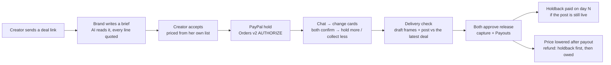

# Amend

**Money that changes when the truth changes.**

Amend is a deal room for creator brand deals. The brand's payment is **held by PayPal before work starts**, every change
in the chat becomes a **priced card both sides confirm**, and nothing is paid out until the **delivery matches the deal**.
Entry for the PayPal AI Hackathon. **PayPal sandbox only. All people and brands are made up.**

**Live:** https://amend-r7le.onrender.com · **Try it in 2 minutes:** https://amend-r7le.onrender.com/try · **Judging guide:** [docs/judging.md](docs/judging.md)

**Judges: start at [/try](https://amend-r7le.onrender.com/try).** It makes a fresh deal for you, with a real PayPal
sandbox hold, and a reset button. A hold made today expires after **29 days** (PayPal's limit), so make a new one
from /try any time. **The first load can take up to 50 s:** Amend runs on Render's free plan, which sleeps when idle.

## The problem

- **Late payment.** 48% of creators said they'd been paid late for work that year ([Lumanu, survey of 500+ creators](https://www.lumanu.com/blog/insights-from-500-influencers-on-their-payment-experience)).
  Brands usually pay 30 days after a campaign goes live, terms are stretching to 45 and 60 days, and agencies report some
  payments arriving 120 days late ([Digiday, Jan 2026](https://digiday.com/future-of-tv/future-of-tv-briefing-the-creators-economys-very-loud-dirty-little-secret-of-brands-late-delayed-payments/)).
- **Scope changes.** "One more Story", "post Monday instead", "brighter colours": the deal changes in the chat after the
  price is set, and nobody updates the money.
- **No proof.** When something goes wrong (a cancellation, a dispute), the agreement is scattered across DMs and voice notes.

## How it works



1. **Deal link.** The creator sends one link; the brand needs no account. The brand writes a brief; the AI turns it into
   lines, each with the exact words it came from. Prices come from the creator's own price list (code, not AI).
2. **Money held before work starts.** The brand pays with PayPal; the money is authorised (held), not taken.
3. **Changes agreed by both.** A message, voice note, screenshot or call that changes the deal becomes an inline change
   card: priced from her list, with a ripple preview (what money moves) and an **untouched count**. Both confirm → PayPal
   updates (a new hold for more, collect less for a decrease). Unclear wording ("drop the story set" when there are two)
   asks "Which one?" before anyone can confirm.
4. **Paid when delivery matches.** Draft frames are taken in the browser and checked against the brief; the post is checked
   against the latest confirmed deal (items, date, #ad). No money is released while a gap is open.
5. **Release.** Both approve; PayPal collects; the creator is paid by Payouts, minus a holdback paid on day N if the post
   is still live.
6. **Afterwards.** A price lowered after payment is a **refund, never a cancel**, carried by the holdback first and then by
   a balance taken from the creator's next payout. A cancellation is split from the evidence (with an independent AI
   second opinion). A PayPal dispute freezes the holdback, and the creator can send a one-page proof to PayPal.
   Usage rights have a clock and an "Extend usage" card.

Every payment is in a **ledger** with the words behind it.

## Built on PayPal: the deal's spine

Every version of a deal maps to PayPal objects, and every PayPal object leads back to the deal. Open any deal's **PayPal
spine** panel to see them, with the status read from PayPal (a GET, "Check PayPal now") or from a verified webhook.

| Deal | PayPal object | What Amend writes into PayPal |
|---|---|---|
| Version accepted, money held | Orders v2 order → Payments v2 **authorization** | `custom_id` = `amend:<deal>:v<version>:<receipt hash>`, `invoice_id` = `AMEND-<deal>-v<version>-<item>` |
| Change confirmed (+$) | comes out of the existing hold, or a **new order + authorization** | the new version's receipt hash |
| Delivery matches: a **signed delivery verdict**, both confirm it | **captures** (`final_capture`: the unused part of the hold goes back to the brand) or a **void** of a hold no longer needed | `PayPal-Request-Id` per capture |
| Creator (and editor) paid | **Payouts** batch + item | `sender_item_id` = `<deal>-v<version>-<item>` |
| Price lowered after payment | **refund** of the capture (never a cancel) | `PayPal-Request-Id` |
| Brand disputes | **dispute** → evidence `PROOF_OF_FULFILLMENT` | the deal record PDF |

**What's new here (and why PayPal is the backbone, not a checkout button):**

- **Hold clock and headroom on screen.** Day N of PayPal's 29-day authorization, the 3-day honour period (after it,
  Amend re-authorises once, automatically, right before collecting), and PayPal's capture headroom (115% or +$75,
  whichever is less). A change card says either "comes out of the existing PayPal hold" or "needs a new PayPal approval
  from the brand".
- **A signed brand mandate bound to the hold (AP2-style).** At hold time the brand can pre-approve up to 3 checkable
  things (an extra item up to $X, a post-date window, #ad). Their browser signs it with an Ed25519 key made on the device;
  Amend verifies the exact text. The PayPal hold becomes the cap (deal + allowed extras), and the mandate's hash is in
  the receipt carried by the PayPal order. A change inside the mandate counts as the brand's confirmation, signed in
  advance; the creator still confirms, and the money comes out of the existing hold with no new PayPal step.
- **The hold is the cap, and the unused part goes back.** "$530 deal + up to $150 pre-approved extras = $680 held."
  At collection every capture is `final_capture`, so PayPal releases what wasn't used; a hold the final deal doesn't
  need is voided. The panel says "$70 released back to Nadia".
- **A signed delivery verdict.** When the post is in, code (not AI) checks it against the confirmed version: pass or
  fail per check, the reason, the confirmed deal's exact words, and the post's hash. On a pass it proposes the release
  (what PayPal collects, the creator's payout, the editor's share, the holdback, what goes back to the brand) and lists
  the exact PayPal calls next to the Confirm button. Amend signs it with Ed25519, using its own key
  (`VERDICT_SIGNING_KEY`). Public key at `/api/verdict/key`; its fingerprint (the key id on every verdict) is
  **`9f88e65db6e92f00`** (public key `T85DpUaWzq1rPVO77AWdoTc2rfxvnyhIYjPIZmh/X2M=`). Nothing moves until both people
  tap Confirm on that exact verdict (bound by its hash).
- **"AI read" and "Code decided" on every check.** When the post is submitted, Gemini reads the caption (e.g. "#ad at
  caption start"), and anything it says must quote the caption word for word or it's dropped. Each check shows what
  the AI read (or "Not read by AI. Sara entered 2") next to what code decided (pass or fail against the confirmed
  quote). Code never reads the AI's reading to decide; the AI never decides money.
- **The post is read from Instagram.** When the creator submits a post link, Amend reads her latest 10 posts through
  Instagram's Business Discovery (the same token as the Discover lookup, never cached) and matches the link. Found:
  the caption and posted time that code checks are Instagram's, not what she typed, and each check shows **Instagram
  read** (type, posted time in Dubai, "#ad at caption start" or not, quoted word for word). **Re-check on Instagram**
  reads it again (rate limited) and signs a new verdict. Stories can't be read for other accounts, so they come from
  the creator's upload. Not found, a personal account, or the lookup switched off: the check uses what she entered
  and says so. The token is never stored; the log carries the media id only.
- **Settle before a dispute.** On a deal with an open delivery gap or a stuck revision, either side can propose a
  settlement instead of going to PayPal. The AI summarises each side's position, quoting only that side's own words
  (anything else is dropped); it sets no money. Code proposes the split from what was delivered against the latest
  confirmed version (e.g. Reel delivered $450 to the creator, Story set not delivered $80 back). Both tap Confirm on
  that exact proposal; it never executes on silence. Then PayPal collects the creator's part with `final_capture`
  (the rest goes back), voids any hold not needed, and pays the creator.
- **Team splits in one Payouts batch.** The creator adds up to 4 people (role, PayPal email, share % of her payout,
  at most 50% in all) and picks the refund rule upfront: "I cover refunds" (default) or "shared by share". At release,
  one PayPal Payouts batch pays her and the team, with a `sender_item_id` per person (in the receipt chain). Each item
  is "sent" until PayPal reports it (webhook `PAYMENT.PAYOUTS-ITEM.*`, or the tick GETs the batch), then paid or
  failed. A failed person is retried alone with a new stored `PayPal-Request-Id`. Each person gets a receipt link
  with no login ("Paid $95.40 for National Day · Editor"). With "shared by share", a refund after payout is split by
  the shares (code, never AI) and comes off each person's future Amend payouts.
- **A performance bonus held by PayPal, released from Instagram insights.** The brand offers it before the post
  ("+$150 if the post reaches 40,000 views, read on day 7 after posting"); the creator confirms; the brand holds the
  bonus with PayPal as its **own hold** (base hold + bonus hold). On day D, Amend reads the views from the post's
  insights and **code decides** met or missed. Both tap Confirm on that exact decision (bound by its hash): met →
  PayPal collects the bonus hold (`final_capture`) and pays the creator by Payouts; missed → the bonus hold is voided
  and all of it goes back. **No screenshots as proof:** if Instagram can't be read by day D + 2, the card says "Results can't
  be verified from Instagram" and both can agree by hand (pay an agreed amount or release it; both pick the same).
  Only if they haven't agreed by day D + 7 is the bonus hold voided, back to the brand, as the bonus terms say. The bonus hold is never part of the base release or a cancellation split (cancelling voids it). PayPal
  holds last 29 days, so day D is 1 to 21 days after posting.
  **Bonus tiers** (up to 3, e.g. 10,000 views +$50, 50,000 views +$150) can be signed in the brand's mandate. The
  brand holds base + top tier (the bonus is its own hold); code picks the highest tier Instagram's numbers reach;
  because the brand pre-signed it, only the creator taps; PayPal collects that tier with `final_capture`, so the rest
  of the bonus hold goes back to the brand. Tiers only add money: the base price never goes down.
- **Brand data from Instagram, every number with its source and "updated X ago"** (stale after 7 days):
  - **Results report** per deal: views, reach, saves and shares from the post's insights, and **cost per 1,000 views =
    paid ÷ views × 1,000**, worked out by code. Refresh button (rate limited) and CSV download.
  - **Disclosure history** on the creator's profile: "#ad on X of Y posts that mention a brand" over the last 12
    captions, with the quotes. The AI only finds the brand mentions (each quoted word for word); code counts. For
    looked-up accounts (real people), nothing goes to the AI: code finds tagged accounts instead.
  - **Exclusivity check:** the brand names the competitors; recent captions that mention one are flagged with the quote
    and the date (code; it never moves money).
  - **Refresh policy:** the connected account nightly (followers and the last 12 posts) and its audience weekly; a live
    deal's post every 6 h for 7 days, then daily until the usage rights end. Business Discovery is cached 24 h.
  - **Connecting Instagram for real creators needs Meta app review; the demo uses my test account.** Insights (views,
    reach, audience) come only from that connected account; other creators show "needs Instagram connected".
- **#ad becomes a money rule only when the brand signs it.** If the signed mandate says "Every post carries #ad", a
  caption without the tag fails the verdict and opens a gap card for the creator ("Add #ad at the start of the
  caption"). No release until it passes, and only a fixed caption closes it (the brand can't wave it through).
  Without that condition, disclosure stays advisory.
- **A receipt chain.** Every deal event (mandate, change card, each confirmation, each PayPal request ID and response ID,
  webhook, evidence) stores the hash of the previous one. The panel shows it verified; one changed byte breaks it.
- **Disputes answered from the record.** On `CUSTOMER.DISPUTE.CREATED`, Amend builds the evidence pack at once (mandate,
  confirmed version, delivery check, post link, chain). The creator taps once, and it goes to PayPal as
  `PROOF_OF_FULFILLMENT`. [`scripts/dispute_sandbox_run.py`](scripts/dispute_sandbox_run.py) runs the sandbox path:
  require-evidence → provide-evidence → adjudicate `SELLER_FAVOR` → `RESOLVED` on the panel.

**Honest limits of this part:**
- We hold the pre-approved cap instead of relying on over-capture. Capturing into PayPal's headroom is built but
  **off** (`PAYPAL_OVERCAPTURE=false`): the meter is informational, and a change beyond what's held needs a new PayPal
  approval.
- The verdict's signature proves Amend's code produced exactly that verdict; it is not a person's approval (the
  Confirm taps are). "Draft approved" is always advisory; disclosure is advisory unless the signed mandate requires it.
- Instagram gives the post's type, time and caption, not how many Story frames went up: counts are what the creator
  entered (the verdict says so). Amend doesn't verify she owns the Instagram account she names (Instagram Login
  would). Only professional accounts can be read, and only their 10 latest posts.
- If `VERDICT_SIGNING_KEY` isn't set, verdicts are signed with a key derived from the session secret (a warning is
  logged, no secret printed), and the fingerprint above won't match. Make a key with `python -m scripts.verdict_key`:
  it writes the seed to a private file and prints only the public key and fingerprint.
- Deals recorded before the receipt chain existed show "Created before receipts"; a chain is never added afterwards.
- A settlement pays the creator her delivered part directly: no holdback and no team split on that money.
- The mandate is "AP2-style" (a signed, scoped, capped intent), not an AP2 implementation.
- On-device signing needs Ed25519 in WebCrypto (Chrome 137+, Safari 17+, Firefox 129+). Older browsers pay without
  pre-approvals and confirm each change live.
- Sending dispute evidence always needs the creator's tap (every PayPal write needs a human approval record).

## PayPal APIs used

| API | Used for |
|---|---|
| Orders v2: create order, `intent: AUTHORIZE` | Hold the brand's money when the deal is accepted, and for each confirmed increase |
| Orders v2: authorize order | Turn the approved order into an authorisation (the hold) |
| Payments v2: capture authorization (partial, `final_capture`) | Collect at release; a cancellation collects only the creator's share |
| Payments v2: void authorization | Release what isn't collected |
| Payments v2: reauthorize | Renew an old hold before collecting (allowed once, day 4–29) |
| Payments v2: refund capture | A correction after payment: refund, never a cancel |
| Payouts | Pay the creator (and an editor's share) |
| Webhooks: verify-webhook-signature | Every webhook is verified, de-duplicated by event id, and never moves a status backwards |
| Disputes: get, provide-evidence (`PROOF_OF_FULFILLMENT`) | Read the dispute; send the deal record, only after the creator approves |
| Disputes: require-evidence, adjudicate (sandbox simulation) | The scripted sandbox run of a dispute won by the seller |
| Orders / Payments / Payouts GETs | "Check PayPal now" on the spine panel (read-only, no money moves) |
| Invoicing v2 | Tried in the day-1 sandbox probe only; not used in the app |

**Idempotency:** every PayPal write carries its own `PayPal-Request-Id`, stored on the money item, so a retry or a double
tap never creates a second payment. **No PayPal write happens without an approval record** bound to that item and amount.

**Webhook events handled:** `CHECKOUT.ORDER.APPROVED`, `PAYMENT.AUTHORIZATION.CREATED / VOIDED`, `PAYMENT.CAPTURE.COMPLETED /
REFUNDED / REVERSED / DENIED`, `PAYMENT.PAYOUTSBATCH.*`, `PAYMENT.PAYOUTS-ITEM.*`, `CUSTOMER.DISPUTE.CREATED / UPDATED / RESOLVED`.

## AI tools used

| Tool | Job |
|---|---|
| **Gemini** (main) | Briefs → deal lines; chat, voice-note and call text → change cards; draft frames → delivery check; reading the caption when the post can't be read from Instagram; "Describe your campaign" → search criteria |
| **Groq Whisper** | Speech-to-text: voice notes and call transcripts. Groq's chat model is the backup if Gemini is busy |
| **NVIDIA** | An independent second opinion on money decisions (the cancellation split); if it disagrees, both views are shown and people decide |
| **Claude Code** | Used to build the app (code, tests, browser checks). It isn't part of the running product |

**The AI never does the maths.** It returns item codes, quantities and quotes; every price, total, split and score is
worked out by code from the creator's list. **No quote, no money:** every quote must appear word for word in its source,
or the AI's answer is rejected. Only confirmed people's words can change money; anyone else's become suggestions.
**Captions of creators who aren't on Amend are never sent to an AI; code reads tagged @accounts instead.**

## Discovery

- **Handle not on Amend yet:** a brand can invite her with a claim link (14 days; Copy or Share on WhatsApp) or save the handle. With a Meta token, Discover also shows her **public Instagram numbers** via Business Discovery (followers, posts, median likes and comments, engagement worked out by code; cached 24 h; 30 lookups per brand per hour). Off unless `IG_LOOKUP_ENABLED=true`.
- **Price privacy per creator:** public (exact prices), a range (her own min–max), or on request (no numbers). Hidden
  prices never appear in any response: price filters use fixed bands, a budget badge says only "fits / slightly above /
  above" (budgets are rounded to a fixed grid so it can't be used to find the price), and a brand sees an on-request
  creator's offer amounts only after she accepts.
- **AI match:** "Describe your campaign" → the AI reads the criteria (each with your exact words); code scores every
  creator with fixed weights (niche, audience country, language, views and engagement, budget fit, availability, track
  record, data quality) and shows the top 10 with "Why this match" reasons built from the score.

## Same engine, other uses

- **Trade counters ↔ contractors:** order changes priced and confirmed, held, and released on line-item proof of
  delivery. About 2 in 5 UAE B2B invoices are paid late (Atradius UAE Payment Practices Barometer, Jul 2026).
- **Small trades jobs:** the deposit is held until the job is proven done. 81,925 US home-improvement scam reports in
  2024, median loss $1,800 (FTC / BBB).
- **Agent-to-agent services:** hold until the output matches the task. Current agent payment protocols record consent,
  not conditional release (AP2, x402, Visa TAP).

## Live-tested on the PayPal sandbox

Full write-up: [docs/live-walk.md](docs/live-walk.md).

| Story | Result |
|---|---|
| Happy path: offer → $530 held → "+1 Story set" → $610 held → draft and post checked → released → creator paid, holdback scheduled | ✅ |
| Cancellation: split 60/40 from evidence, NVIDIA second opinion shown, partial capture + Payouts, rest released, PayPal fee recorded | ✅ |
| Refund after payout: voice note "drop the story set" → one Story set (S102) → $80 refund = $61 from the holdback + $19 owed | ✅ |
| Owed balance recovered from the next payout ($99) | ✅ |
| Call upload: browser converts to WAV, speakers separated, "no change" when nothing changed | ✅ |
| Webhooks: order approved, authorization created, capture completed, capture refunded, payouts batch + item | ✅ verified |
| `/try` judge walk: $70 held → "Add a Story and post Monday" → $95 held | ✅ |
| On-request creator: no amounts before she accepts, real price after, PayPal hold succeeds | ✅ |
| Discover AI match with reasons; no hidden price in any response | ✅ |
| PayPal dispute shield | Tested with PayPal mocked (S126–S130); see live-walk for the sandbox status |

**Tests:** 694 automated tests (PayPal and every AI provider mocked; no test calls a real service), plus browser runs at 390 and 1440 px.

## Honest limits

- **Sandbox only**, USD only (AED shown at a fixed 3.6725).
- **Holding money for others needs PayPal's pre-approval in production** (PayPal Acceptable Use Policy); the demo runs
  in sandbox.
- **Real Instagram numbers come from one test creator only** ("Test creator · @clinicrobotest", the account linked to
  Amend's token). Sara and the other creators are demo data and never use Instagram. The test creator is hidden from
  Discover unless its handle is searched.
- **Platform account + Payouts instead of marketplace mode.** The brand pays Amend's sandbox business account and the
  creator is paid by Payouts. PayPal's marketplace setup (the brand pays the creator directly, with Amend's fee and a
  delayed release) needs PayPal partner approval (the sandbox returned 403 / 422 on 7 Nov). Only the "rail" changes.
- **PayPal fees are a platform cost**, never taken from the creator; in production Amend's own fee covers them.
- **WhatsApp alerts: coming soon** (waiting for Meta template approval). Alerts appear in Amend.
- **Hosting:** Render (free plan, Docker) with Postgres on Supabase; the free plan can sleep when idle, so the first page can be slow.
- **Instagram lookup** uses Meta Business Discovery with a test app's token: public numbers for business and creator accounts only.
- The UAE permit check is a format and expiry check only. Collecting a usage-rights extension hold isn't built yet.

## Next

Not in yet, and why:
- **Team splits beyond the basics:** a team member's own Amend account and payout history, and splitting the
  holdback too. *Today the team is paid from the main payment only, and a member sees their receipt link, not an
  account.*
- **Tax and VAT documents** (UAE VAT invoices, the creator's tax details on statements). *They need rules per country
  and a reviewed invoice format; a wrong tax document is worse than none.*
- **Collecting usage extensions:** charging the brand when content is used past the usage-rights end. *Amend sees the
  end date and opens an extension card, but proving use (ads libraries, reposts) isn't reliable yet, and AI must never
  set the price.*
- **Multi-platform tracking** (TikTok, YouTube, Snapchat). *Each needs its own app review and API; Instagram first.*
- Retainers with a monthly PayPal hold. *PayPal holds last 29 days, so a retainer needs a new hold each month.*
- Results reports at 7 and 30 days for creators who aren't connected. *Insights need the creator's own Instagram
  connection (Meta app review).*

## Run it locally

Prerequisites: Python 3.12 and git. For real PayPal calls: a [PayPal developer](https://developer.paypal.com) account.

```bash
git clone https://github.com/alifiya-saifee/amend.git && cd amend
python3.12 -m venv .venv
.venv/bin/pip install -r requirements.txt
cp .env.example .env      # fill in your own values; never commit .env
.venv/bin/uvicorn amend.app:app --port 8000
# open http://localhost:8000 (demo creators are seeded on first start; SQLite is used when DATABASE_URL is empty)
```

**No keys at all?** Run with `AMEND_FAKE=1 PAYPAL_ENV=sandbox BASE_URL=http://localhost:8000` for a fake PayPal and a
rule-based AI (local only: it refuses to turn on unless `BASE_URL` is localhost).

**Sandbox setup (real PayPal sandbox calls):**
1. In the PayPal developer dashboard → Apps & Credentials (Sandbox) → create an app. Put its client ID and secret in
   `PAYPAL_CLIENT_ID` / `PAYPAL_CLIENT_SECRET`, and set `PAYPAL_ENV=sandbox` (the app refuses to start otherwise).
2. Sandbox → Accounts: use the business account as the platform, and create personal accounts for the brand (the
   buyer), the creator and an editor. Put their emails in `SANDBOX_BRAND_EMAIL`, `SANDBOX_CREATOR_EMAIL`, `SANDBOX_EDITOR_EMAIL`.
3. Make sure Payouts is enabled for the app (sandbox). For webhooks, add a webhook to `<BASE_URL>/api/paypal/webhook`
   (`CHECKOUT.ORDER.*`, `PAYMENT.AUTHORIZATION.*`, `PAYMENT.CAPTURE.*`, `PAYMENT.PAYOUTSBATCH.*`, `CUSTOMER.DISPUTE.*`) and put its ID in `PAYPAL_WEBHOOK_ID`.
4. Set `AMEND_DEMO_PASSWORD`, `AMEND_SESSION_SECRET` and `AMEND_TICK_SECRET` to long random strings, and
   `VERDICT_SIGNING_KEY` with `python -m scripts.verdict_key`. AI keys (`GEMINI_API_KEY`, `GROQ_API_KEY`,
   `NVIDIA_API_KEY`) are optional; without them, the AI features say they're busy.
5. Step-by-step sandbox walks are in [SANDBOX_TESTING.md](SANDBOX_TESTING.md).

Environment variables (values never go in the repo): `PAYPAL_ENV`, `PAYPAL_CLIENT_ID`, `PAYPAL_CLIENT_SECRET`,
`PAYPAL_WEBHOOK_ID`, `DATABASE_URL`, `BASE_URL`, `MONEY_RAIL`, `GEMINI_API_KEY`, `GEMINI_MODEL`, `GROQ_API_KEY`,
`GROQ_MODEL`, `NVIDIA_API_KEY`, `NVIDIA_MODEL`, `AMEND_DEMO_PASSWORD`, `AMEND_SESSION_SECRET`, `AMEND_TICK_SECRET`, `VERDICT_SIGNING_KEY`,
`SANDBOX_BRAND_EMAIL`, `SANDBOX_CREATOR_EMAIL`, `SANDBOX_EDITOR_EMAIL`, `IG_LOOKUP_ENABLED`, `META_IG_TOKEN`, `META_IG_USER_ID`.

**Tests:** `.venv/bin/pytest -q` (PayPal and AI mocked). Browser checks live in `tests/browser/`.
**How to judge it:** [docs/judging.md](docs/judging.md).

## Safety rules (always on)

1. PayPal sandbox only: the app refuses to start unless `PAYPAL_ENV=sandbox`. Secrets come only from environment variables.
2. No PayPal write without an approval record bound to that money item and amount; every write has its own `PayPal-Request-Id`.
3. No quote, no money. Only confirmed parties' words can change money.
4. Paid means refund, never cancel; PayPal's live status is checked first.
5. Conflicting instructions pause the deal.
6. The event log is append-only (database triggers refuse updates and deletes).

## Stack

Python 3.12 · FastAPI · httpx · Pydantic v2 · SQLite locally, Postgres (Supabase) on Render · plain HTML + JS (mobile-first,
installable) · GSAP on the marketing page · pytest + respx + Playwright.

**Built with AG Grid Community** (MIT, v32.2.0 from jsdelivr, pinned): the Ledger, Earnings and each deal's PayPal
objects table. Sorting, column filters, quick search, CSV export, and a row tap that opens the receipt hash and the
PayPal IDs. Columns: date, deal, version, PayPal step, PayPal ID, amount, status, and source (PayPal's **reply** to
Amend's call, a **GET** Amend made, or a verified **webhook**). The totals are worked out by the server, not the grid.

The same engine powers **Diwan**, an AI back office for Dubai brokerages.

## Licence

MIT © 2026 Alifiya Saifee
